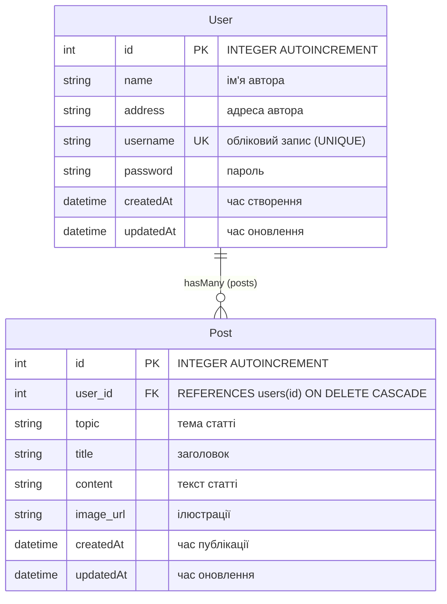

# Лабораторна робота №4: REST API на Node.js та Express з ORM Sequelize

**Тема:** REST API на Node.js та Express. CRUD операції в базі даних.  
**Виконав:** студент групи **ІП-34** **Вівдиченко Максим Сергійович**  
**Варіант №9**: *«Спроектувати базу даних про авторів web-сайту і їх статтях: ім'я, адреса, обліковий запис, пароль, тема, заголовок, текст статті, ілюстрації.»*

---

## 🚀 Технологічний стек

- **Платформа:** Node.js (v20+)
- **Веб-фреймворк:** [Express.js](https://expressjs.com/) v4
- **ORM (Object-Relational Mapping):** [Sequelize](https://sequelize.org/) v6
- **База даних:** [SQLite](https://sqlite.org/) (файл `lab4.db` через драйвер `sqlite3`)
- **UI та API Документація:** [Swagger UI](https://swagger.io/) + **[swagger-jsdoc](https://www.npmjs.com/package/swagger-jsdoc)** (динамічна генерація специфікації OpenAPI 3.0 на льоту з JSDoc-коментарів у коді роутів)
- **Архітектура:** Модульні ES Modules (`import`/`export`)

---

## 💡 Як це влаштовано (шпаргалка для захисту)

1. **Чому Sequelize ORM?**
   - Замість прямих SQL-запитів (`SELECT`, `INSERT`), робота з базою ведеться через об'єктно-орієнтовані моделі `User` та `Post`.
   - Всі зв'язки (1:N — один автор має багато статей) та каскадне видалення налаштовані декларативно:
     ```javascript
     User.hasMany(Post, { foreignKey: 'user_id', as: 'posts', onDelete: 'CASCADE' });
     Post.belongsTo(User, { foreignKey: 'user_id', as: 'author' });
     ```
   - Запити стали безпечними (захист від SQL Injection "з коробки") та лаконічними (`User.findAll()`, `User.findByPk(id, { include: 'posts' })`).

2. **Як генерується Swagger "на льоту"?**
   - Використовується бібліотека `swagger-jsdoc`.
   - Документація пишеться у вигляді стандартних JSDoc-коментарів (`/** @openapi ... */`) безпосередньо над відповідними функціями маршрутів у [`src/routes/users.routes.js`](src/routes/users.routes.js) та [`src/routes/posts.routes.js`](src/routes/posts.routes.js).
   - При запуску сервера `swagger-jsdoc` автоматично аналізує файли роутів, збирає єдиний OpenAPI 3.0 документ та передає його в `swagger-ui-express`. Будь-яка зміна в описі ендпоінта одразу відображається у UI без ручного оновлення статичних JSON-файлів.

---

## 🗄 Моделі даних (Варіант 9)



---

## 📋 Архітектура REST API (Канонічні принципи REST)

Маршрути організовано строго за стандартами RESTful архітектури:
- **Іменники замість дієслів у URL:** шляхи визначають лише колекції та ресурси (`/api/users`, `/api/posts`).
- **Проєкції та зв'язані сутності через Query Parameters:** замість штучних шляхів виду `/with-author` використовується стандартний параметр `?include=author` або `?include=posts`.
- **Фільтрація через Query Parameters:** фільтрація постів за автором чи темою виконується через `?userId=1&topic=Web`.
- **Ієрархічні підресурси (Sub-resources):** `/api/users/:id/posts` для колекції постів конкретного користувача.
- **Статуси відповідей HTTP:** створення — `201 Created`, видалення — `204 No Content`, оновлення/читання — `200 OK`.

### Колекція Авторів (`/api/users`)
| Метод | Маршрут | Опис |
| :--- | :--- | :--- |
| `GET` | `/api/users` | Отримати всіх авторів (підтримує `?include=posts`) |
| `POST` | `/api/users` | Створити автора (`201 Created`, валідація, `409` при дублікаті логіна) |
| `GET` | `/api/users/:id` | Отримати одного автора за ID (підтримує `?include=posts`) |
| `PUT` / `PATCH` | `/api/users/:id` | Повне або часткове оновлення даних автора |
| `DELETE` | `/api/users/:id` | Видалити автора та його статті каскадно (`204 No Content`) |
| `GET` | `/api/users/:id/posts` | **Підресурс:** отримати всі статті автора за його ID |
| `POST` | `/api/users/:id/posts` | **Підресурс:** створити нову статтю для автора з цим ID |

### Колекція Статей (`/api/posts`)
| Метод | Маршрут | Опис |
| :--- | :--- | :--- |
| `GET` | `/api/posts` | Отримати список статей.<br>• **Сирий список:** без параметрів<br>• **З автором:** `?include=author`<br>• **Фільтрація:** `?userId=1`, `?topic=Web` |
| `POST` | `/api/posts` | Створити статтю (`201 Created`, валідація наявності автора) |
| `GET` | `/api/posts/:id` | Отримати статтю за ID.<br>• **Сирий пост:** без параметрів<br>• **З автором:** `?include=author` |
| `PUT` / `PATCH` | `/api/posts/:id` | Оновити статтю |
| `DELETE` | `/api/posts/:id` | Видалити статтю (`204 No Content`) |

---

## 🛠 Запуск та перевірка

### 1. Встановлення залежностей:
```bash
npm install
```

### 2. Запуск сервера:
```bash
npm start
```
*(або `npm run dev` для режиму розробки з автоперезавантаженням)*

### 3. Інтерактивний Swagger UI:
Відкрийте у браузері:  
👉 **[http://localhost:3000/docs](http://localhost:3000/docs)** (або головну сторінку [http://localhost:3000](http://localhost:3000))

Тут доступні кнопки **«Try it out»** для виконання запитів, форми введення даних, перегляд схем DTO та кодів відповідей.
