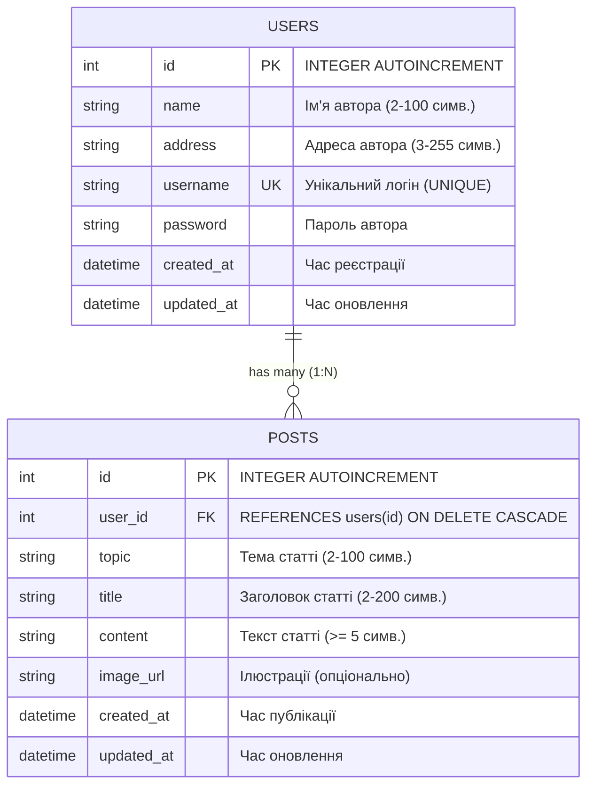

# Лабораторна робота №5: Створення власного API на Python (FastAPI)

**Тема:** Створення власного API на Python (FastAPI).  
**Виконав:** студент групи **ІП-34** **Вівдиченко Максим Сергійович**  
**Варіант №9**: *«Спроектувати базу даних про авторів web-сайту і їх статтях: ім'я, адреса, обліковий запис, пароль, тема, заголовок, текст статті, ілюстрації.»*

---

## 🚀 Технологічний стек

- **Мова програмування:** Python 3.10+
- **Веб-фреймворк:** [FastAPI](https://fastapi.tiangolo.com/) (сучасний, високопродуктивний фреймворк для створення REST API)
- **ASGI Сервер:** [Uvicorn](https://www.uvicorn.org/)
- **ORM (Object-Relational Mapping):** [SQLAlchemy 2.0](https://www.sqlalchemy.org/) — взаємодія з базою даних через декларативні Python-моделі без використання сирого SQL
- **База даних:** [SQLite](https://www.sqlite.org/) (`lab5.db`) з увімкненою підтримкою зв'язків (`PRAGMA foreign_keys=ON`) та каскадного видалення (`ON DELETE CASCADE`)
- **Валідація та схеми:** [Pydantic v2](https://docs.pydantic.dev/) — сувора типізація запитів і відповідей, регулярні вирази, валідація обмежень довжини
- **UI та інтерактивна документація:** Автозгенерований **Swagger UI** (OpenAPI 3.1) за адресою `http://127.0.0.1:8000/docs` (також доступний ReDoc за адресою `/redoc`)

---

## 📋 Особливості та виконані вимоги

1. **Ідентичність ендпоінтів до Лабораторної роботи №4:**
   - Повністю повторено структуру маршрутів, параметри запитів (`include=posts`, `include=author`, `userId`, `topic`), підресурсні маршрути (`/api/users/{id}/posts`), HTTP статус-коди (`200`, `201`, `204`, `400`, `404`, `409`) та формат відповідей помилок `{ "error": "...", "message": "..." }`.
2. **Взаємодія з БД виключно через ORM (SQLAlchemy):**
   - Декларативні моделі `User` та `Post` зі зв'язком `1:N` (`relationship`).
   - Усі запити виконуються методами ORM (`db.query()`, `db.add()`, `db.commit()`, `db.delete()`, `joinedload()`).
3. **Автозгенерований Swagger UI замість ручного інтерфейсу:**
   - Swagger UI генерується фреймворком на льоту на основі OpenAPI 3.1 специфікації.
   - Кореневий URL `http://127.0.0.1:8000/` автоматично перенаправляє у Swagger UI.
   - Будь-який запит можна протестувати у браузері через інтерактивну кнопку **«Try it out»**.
4. **Автоматичне наповнення даними (Seeding):**
   - При старті застосунку база даних створюється автоматично та заповнюється записами авторів (включно з даними студента) і початковими статтями.

---

## 🗄 Структура бази даних (Варіант 9)



---

## 📂 Структура проєкту

```
Lab-5/
├── database.py         # Налаштування SQLAlchemy ORM, підключення SQLite, моделі User/Post та seeding
├── schemas.py          # Pydantic v2 схеми валідації та OpenAPI-серіалізації
├── main.py             # Точка входу FastAPI, CORS, обробники помилок, редирект на /docs
├── routers/
│   ├── __init__.py
│   ├── users.py        # Ендпоінти для авторів (/api/users, /api/users/{id}/posts)
│   └── posts.py        # Ендпоінти для статей (/api/posts)
├── requirements.txt    # Мінімальні залежності проєкту
├── .gitignore          # Ігнорування службових файлів та бази даних
└── README.md           # Документація лабораторної роботи
```

---

## 🛠 Встановлення та запуск

### 1. Встановлення залежностей
```bash
pip install -r requirements.txt
```

### 2. Запуск сервера

Запуск через Python:
```bash
python main.py
```

Або за допомогою Uvicorn:
```bash
uvicorn main:app --reload
```

Після запуску відкрийте браузер:
👉 **Інтерактивний Swagger UI:** [http://127.0.0.1:8000/docs](http://127.0.0.1:8000/docs) (або [http://127.0.0.1:8000](http://127.0.0.1:8000))  
👉 **ReDoc:** [http://127.0.0.1:8000/redoc](http://127.0.0.1:8000/redoc)

---

## 🌐 Специфікація REST API ендпоінтів (ідентично до Lab-4)

### Автори (`/api/users`)

| Метод | Маршрут | Опис | Коди відповідей |
|---|---|---|---|
| `GET` | `/api/users` | Отримати список авторів (опціонально `include=posts`) | `200` |
| `GET` | `/api/users/{id}` | Отримати автора за ID (опціонально `include=posts`) | `200`, `400`, `404` |
| `GET` | `/api/users/{id}/posts` | Отримати всі статті вказаного автора (REST підресурс) | `200`, `400`, `404` |
| `POST` | `/api/users/{id}/posts` | Створити нову статтю для автора (REST підресурс) | `201`, `400`, `404` |
| `POST` | `/api/users` | Створити нового автора (валідація унікальності логіна) | `201`, `400`, `409` |
| `PUT` | `/api/users/{id}` | Оновити дані автора | `200`, `400`, `404`, `409` |
| `PATCH` | `/api/users/{id}` | Частково оновити дані автора | `200`, `400`, `404`, `409` |
| `DELETE` | `/api/users/{id}` | Видалити автора та всі його статті (каскадно) | `204`, `400`, `404` |

### Статті (`/api/posts`)

| Метод | Маршрут | Опис | Коди відповідей |
|---|---|---|---|
| `GET` | `/api/posts` | Отримати статті (параметри: `include=author`, `userId`, `topic`) | `200`, `400` |
| `GET` | `/api/posts/{id}` | Отримати статтю за ID (опціонально `include=author`) | `200`, `400`, `404` |
| `POST` | `/api/posts` | Створити статтю (перевіряє існування `user_id`) | `201`, `400` |
| `PUT` | `/api/posts/{id}` | Оновити статтю (перевіряє існування нового `user_id`) | `200`, `400`, `404` |
| `PATCH` | `/api/posts/{id}` | Частково оновити статтю | `200`, `400`, `404` |
| `DELETE` | `/api/posts/{id}` | Видалити статтю | `204`, `400`, `404` |
